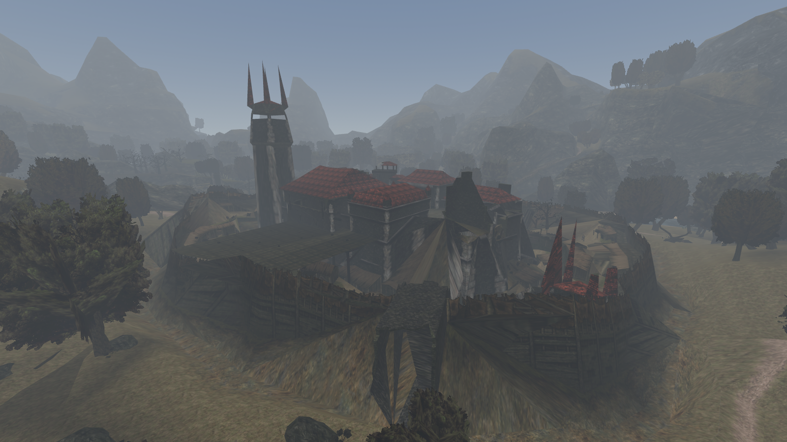
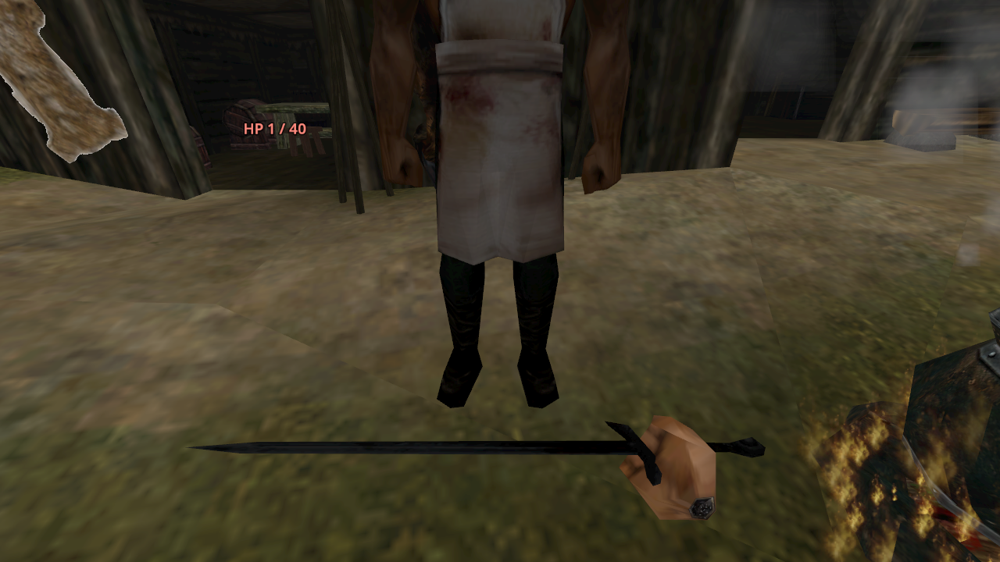

# Gothic Godot (VR)

&color=478cbf)

Gothic 1 and 2 in the **Godot engine** (4.7, C#), with a focus on native VR. This is a port of [Gothic-Unity](https://github.com/Gothic-Unity-Project/Gothic-Unity) away from Unity: same goal, same approach (all game data is loaded at runtime from your own Gothic installation, nothing is bundled), different engine.

> [!IMPORTANT]
> This is a **port study**, not a playable release. It answers whether Gothic-Unity could move to Godot, measures it on a Quest 3, and works out the problems on the way. Setting it up still takes developer knowledge, see [Toolchain](docs/wiki/Toolchain.md).

## Why Godot

Gothic-Unity depends on one vendor's decisions (licence terms, runtime fees, platform support). Godot is MIT licensed, runs C#, and has OpenXR for Quest, Pico and PC VR built in. The study looks at what a move would cost and which problems block it: [Godot risks](docs/wiki/Godot-Risks.md).

## What works so far

Tested on the Linux desktop with headless scripted tests (18 of them, Gothic 1 and 2); the world renders on a Quest 3 at 120 Hz:

- Gothic 1's Old Camp and Gothic 2's Khorinis: world, objects, particles, Gothic's baked light, time of day with day and night, occlusion culling
- Scripted NPCs and monsters with their daily routines, AI states, freepoints and smalltalk on Gothic's Daedalus VM
- Dialogs with choices, voices and subtitles; Gothic's DirectMusic score by zone and time of day; sound effects
- VR player: walking, teleport, the hero's own hands; taking, throwing, eating and drinking items; the bag
- Chests and doors, keys and lock picks
- Fighting: the hero's hits and NPCs fighting back, with Gothic's damage rules

What is left and what can still be optimized: [Work log](docs/wiki/Work-Log.md) and [Headset test](docs/wiki/Headset-Test.md).

## Getting started

You need Linux, [Godot 4.7.2 .NET](https://godotengine.org/download), the .NET SDK 8 (and 9 for Quest builds) and an installed Gothic 1 or Gothic 2.

1. `cd Godot && ./setup.sh` - fetches ZenKit, dmusic and the OpenXR vendors plugin, and builds our two library fixes ([Upstream forks](docs/wiki/Upstream-Forks.md)). `Godot/nuget.config` points to the SDK packages next to the Godot editor; adjust the path to your install.
2. Run it: `godot --path Godot -- --data=<your Gothic folder> --player=true --ai=true` (add `--game=2` for Gothic 2).
3. Desktop keys: WASD and mouse, Shift to run, F to talk or open, right mouse to take, B to put away, Tab for the bag, U to eat or drink, left mouse to hit.

All options, headless tests and the Quest build: [Toolchain](docs/wiki/Toolchain.md).

## How it relates to Gothic-Unity

- This repository is a fork of Gothic-Unity. Its Unity project (`Assets/`, `Packages/`, `ProjectSettings/`) is still here: it is the history and the source of the shared code, and it keeps the fork mergeable with Gothic-Unity's work.
- The Godot project lives in `Godot/`. It compiles part of Gothic-Unity's engine-free core straight from `Assets/Gothic-Core/Scripts` (78 files so far, through a small Unity stand-in): [Porting strategy](docs/wiki/Porting-Strategy.md).
- Fixes we need in other projects are kept as patches in `forks/` and meant to go upstream.

## Documentation

The pages in [`docs/wiki`](docs/wiki/Home.md): [Home](docs/wiki/Home.md), [Godot risks](docs/wiki/Godot-Risks.md), [Spike plan](docs/wiki/Spike-Plan.md), [Porting strategy](docs/wiki/Porting-Strategy.md), [Upstream forks](docs/wiki/Upstream-Forks.md), [Toolchain](docs/wiki/Toolchain.md), [Headset test](docs/wiki/Headset-Test.md), [Work log](docs/wiki/Work-Log.md).

## How we use AI

Built with agentic engineering like Gothic-Unity: the owner sets the direction and decides, an AI agent builds, measures and documents under that guidance. Ground rules: [AI_USE.md](./AI_USE.md).

## Credits

- [Gothic-Unity](https://github.com/Gothic-Unity-Project/Gothic-Unity) - the project this port comes from, and the rules most of the systems here follow.
- [ZenKit](https://github.com/GothicKit/ZenKit) and [dmusic](https://github.com/GothicKit/dmusic) - Gothic's assets and DirectMusic, parsed at runtime.
- [OpenGothic](https://github.com/Try/OpenGothic) - the reference for how the engine behaves.
- [Godot](https://godotengine.org) and the [Godot OpenXR vendors plugin](https://github.com/GodotVR/godot_openxr_vendors).

Gothic is a trademark of its owners; you need your own copy of the games. Licence: [GPL v3](./LICENSE), like Gothic-Unity.
