# Work log

Newest first.

## 2026-11-07 - Chests

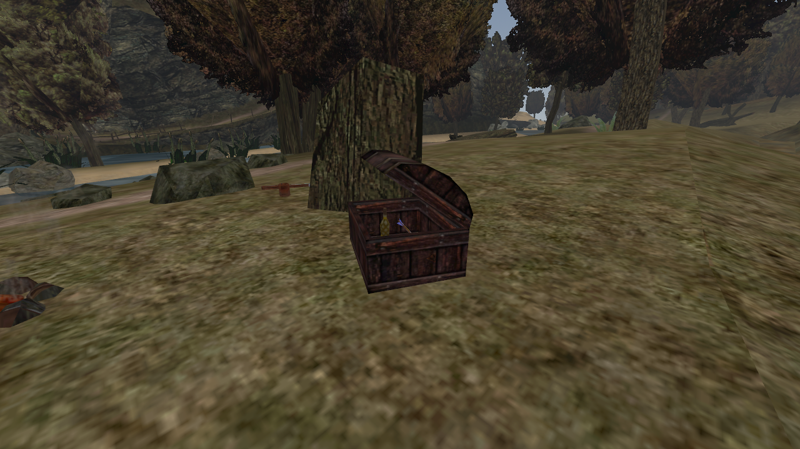

- Chests (oCMobContainer) leave the merged cells: each is its own animated model through the model factory (body and lid are rigid parts on two bones), closed S_S0, opening T_S0_2_S1, open S_S1, closing T_S1_2_S0, with a box collider like the merged chests had (cdStatic).
- The first opening lays the contents out inside (the ZEN's list, e.g. `ITKELOCKPICK:3,ITFOBEER:2,ITLSTORCH:2,ITAMARROW:10`, parsed with Gothic-Unity's own ContentItem code from the shared core): one item per entry standing for its amount, so a stack of 10 arrows goes into the bag as 10.
- XR: the grip with an empty hand on the lid (no item in reach) opens or closes it; desktop: F at a chest in front within 2.2 m when no NPC to talk to is in front.
- Old Camp: 249 chests, 193 of them locked (a key or a lock combination) - those stay shut until lock picking exists. Khorinis: 158, 108 locked.
- Chests get their own physics layer (mobs): solid for the player and for items, but not a "wall" for the desktop pick, which otherwise stopped at the chest's box before reaching the coins inside. Flat items (coins, letters) get a thin box instead of a convex hull without thickness.
- Texture array: items can now appear after loading (chest contents, items out of the bag), but the array is built once; every item that can show up (chest contents, all NPC and hero inventories) is loaded before it is built. Items from scripts at run time (Wld_InsertItem, rewards with new items) will need a growing array or a second material.
- `--chest-test=true`: walks to the nearest unlocked chest with contents, opens it (and checks the desktop pick finds that chest), takes the first item out and puts it into the bag: G1 3 lock picks, G2 32 gold. `--open-chests=true` opens every unlocked chest for shots.

## 2026-11-07 - Monsters: every model with its own skeleton

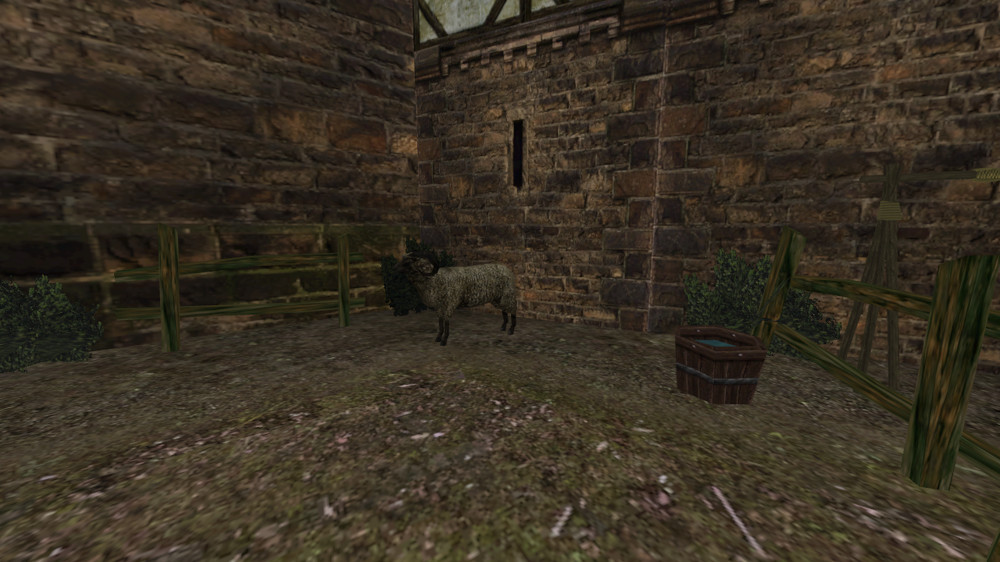
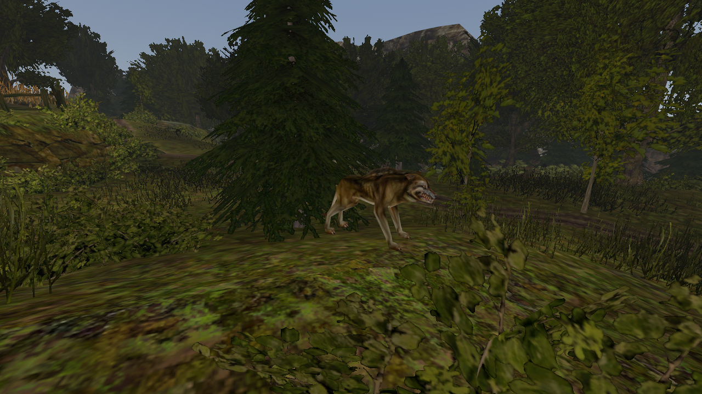

- The human-only model code is now a model factory per model script (HUMANS, WOLF, SHEEP, MEATBUG, ...): skeleton from the model's .MDH (or its .MDL), bodies from .MDM soft skins plus rigid parts hanging on one bone (meatbugs, later chest lids and doors), animations from {MODEL}-{ANI}.MAN.
- Monsters spawn from the startup scripts like the humans: Khorinis 59 monsters of 11 models within 150 m (all of them; before: all left out), Old Camp 3. Idle and walk clips by model (humans S_RUN / S_WALKL, monsters S_FISTRUN / S_FISTWALKL); monsters without a routine start their start state (ZS_MM_AllScheduler).
- `--shots=%MODEL,distance` frames the first NPC of a model.
- Cost: Khorinis with 239 scripted NPCs, AI 0.05 ms per frame on the desktop, animation 0.42 ms (20 animated within the view).

## 2026-11-07 - Eating and drinking

- Food and potions (ITEM_KAT_FOOD, ITEM_KAT_POTIONS from the scripts) held at the mouth for 0.3 s (XR) or U while holding them (desktop) are used up: the item's on_state[0] function runs with self = the hero and item = the item, like Gothic-Unity's AI_UseItem. Npc_ChangeAttribute keeps HP and mana between 0 and their max (Gothic-Unity's rule).
- Hit points on the inside of the left wrist (XR) or top left (desktop).
- `--grab-test=use`: after the bag test the hero is hurt to 10 HP, a healing potion (ITFO_POTION_HEALTH_01) comes out of the bag into the hand and is drunk: 10 -> 40 HP.

## 2026-11-07 - The bag: put items away, take them out

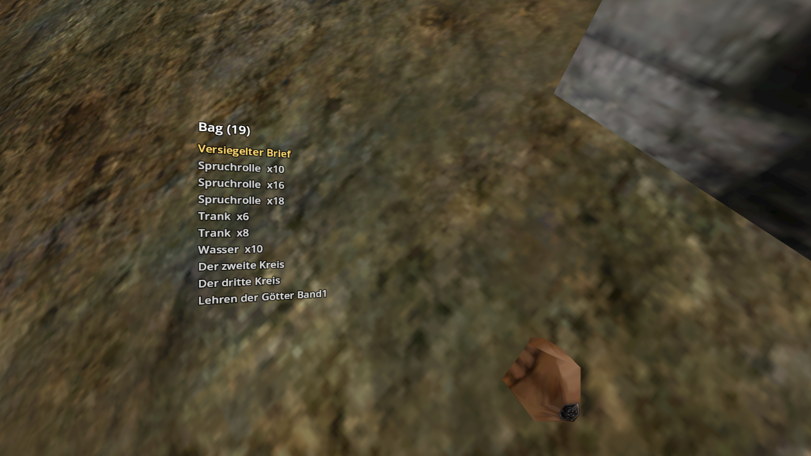

- Inventories for the hero and every NPC, filled by the scripts through Gothic's externals (CreateInvItem(s), Npc_RemoveInvItem(s), Npc_HasItems, with Gothic-Unity's signatures), so dialogs that give or take items and conditions that ask for them work. The hero starts with what his script instance gives him (G1: the sealed letter, scrolls, potions, books, weapons, 200 ore nuggets).
- Putting away: let go of an item over the shoulder (XR, like Gothic-Unity's backpack: within 30 cm of a point behind and below the head) or press B while holding it (desktop).
- Taking out: Y or the left menu button (XR) / Tab (desktop) opens the list in front of the eyes, names from the item scripts with amounts; point or use the right stick (XR), arrow keys / W / S / 1-9 (desktop); the trigger / Enter puts one item into the right hand. Closed during dialogs.
- `--grab-test=bag`: takes the nearest item, puts it away (amount +1), opens the bag, takes it out into the hand (amount -1), throws it. Passes in the Old Camp with the AI on.
- Not in it yet: Gothic's categories and the inventory screen, using items (eating, drinking, reading), equipping weapons and armour, trading, chests.

## 2026-11-07 - The hero's hands

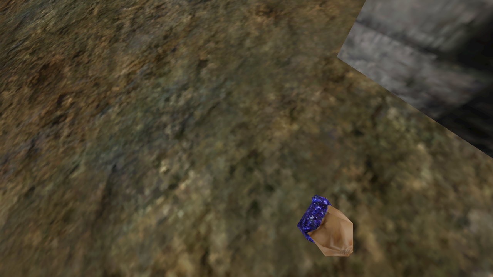

- The boxes are gone: each hand is the hero's own body mesh (his skin from the scripts, later his armour's gloves) on a skeleton of its own where only the hand bone and its finger bone are posed - Gothic's hands are mittens with one finger bone. Every other bone is shrunk to the wrist, so the arm's vertices vanish there and the wrist closes.
- The hand lies in the controller's grip pose (fingers along -Z, palm towards the other hand, the palm's middle at the grip point) and the finger bone bends up to 75° with the grip. A check at setup makes sure closing moves the finger tip towards the palm.
- Desktop: the right hand sits low right in front of the eyes and closes while it holds an item.
- `--hand-preview=true` shows both hands from the side (one open, one closed). Not tried in a headset yet: the grip pose alignment needs a look there.

## 2026-11-07 - Items: take them, throw them

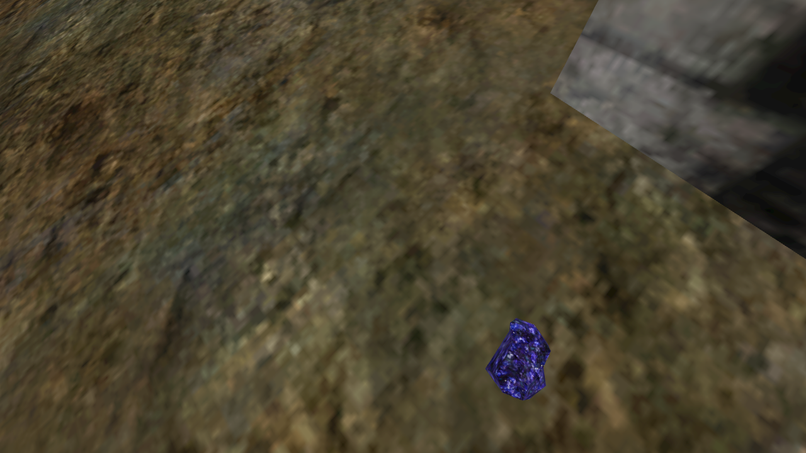
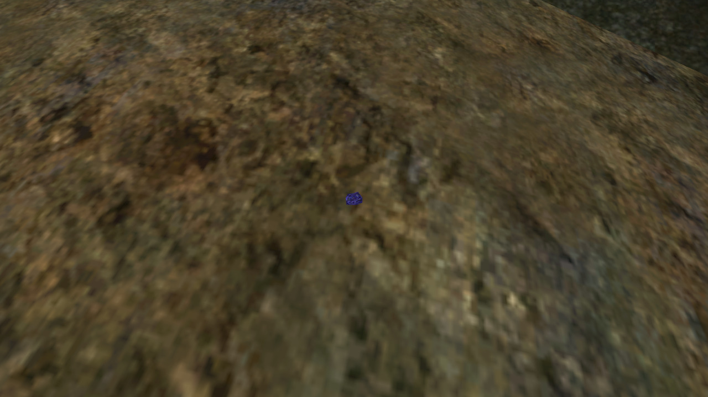

- The world's items (oCItem) stay out of the merged cells: each one is its own body, frozen where Gothic put it (no physics cost) until a hand takes it. Their meshes come from the scripts (C_ITEM.visual), the ZEN stores only the instance name. G1: 746 of 749 items.
- Our own interaction instead of Godot XR Tools (GDScript only, see [[Godot-Risks]]): a C# grab hand. XR - the grip takes the nearest item within 12 cm of the hand and keeps it where it was touched; desktop - the right mouse button takes the item nearest the view line within 2.5 m into a hand in front of the camera. Letting go throws it with the hand's velocity and turn (averaged over 4 physics frames).
- Physics layers: world, player, items. Items land on the world and on each other; the player walks through them; the player's ground and teleport rays only see the world.
- Items are hidden beyond 25 m (`--item-far`): every item is a draw call. Old Camp view with many items: 347 draws instead of 330, physics 0.2-0.3 ms with and without them.
- Tested without a headset (`--grab-test=true`): walks up to the nearest item outdoors, takes it, turns, lets go: an ore nugget thrown 1.3 m, at rest on the ground.
- Found on the way: Gothic's items often sink into the table or shelf they lie on, so a pick ray stops at the furniture; the desktop pick reaches 0.5 m past the first surface.
- Not in it yet: inventory (putting items away, Gothic's bag), items from the scripts (Wld_InsertItem), the hero's real hands, two-handed weapons, chests and other mobs.

## 2026-11-07 - Music: Gothic's DirectMusic score

- Gothic's themes (C_MUSICTHEME in MUSIC.DAT) through dmusic, like Gothic-Unity's music: the music zone the hero is in (the zone playing stays while he is inside, else the last zone containing him in world order, else the world's default zone), day 4:00-21:00 or night (night falls back to day), transitions with the theme's embellishment and timing.
- dmusic renders on its own thread into an AudioStreamGenerator (chunks of 1024 frames, 0.2 s buffer), like Unity's audio callback in Gothic-Unity: nothing on the main thread. Desktop cost 18-24 ms per second on the music thread, no underruns after loading.
- Tested headless (`--shots` through the zones, `--record-audio=file.wav` saves what the master bus mixed): Ore Barons (default theme), Old Camp `oc_day_std.sgt`, Bandit camp `ban_day_std.sgt`, New Camp `nci_day_std.sgt`; the recording has music (RMS 0.02-0.06).
- **dmusic-cs bug**: the first zone change after a garbage collection ended the process - the loader's resolver delegate had been collected. Fixed in a dmusic-cs patch, see [[Upstream-Forks]]; possibly behind some of Gothic-Unity's music crashes in the editor (Mono), not on the Quest (IL2CPP).
- Headless renders mix sound with Godot's Dummy driver now (`tools/render.sh`, `AUDIO_DRIVER=PulseAudio` to hear it); before, test runs played voices on the machine's speakers.
- Not in it yet: fight and threat music (needs the fight AI), reverb from the theme, volume from Gothic.ini, sound effects and ambient sounds.

## 2026-11-07 - Dialogs: choices, voices, subtitles

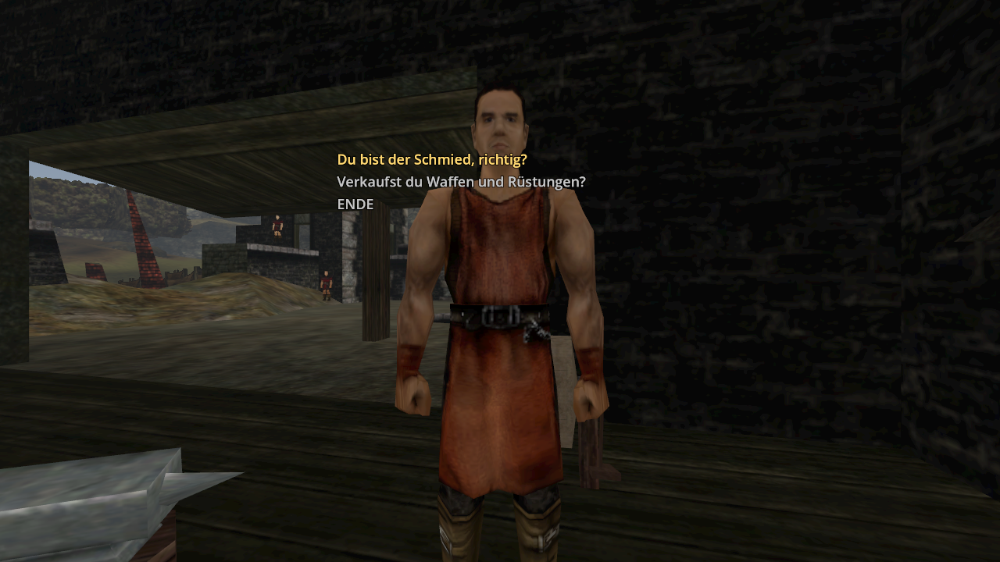
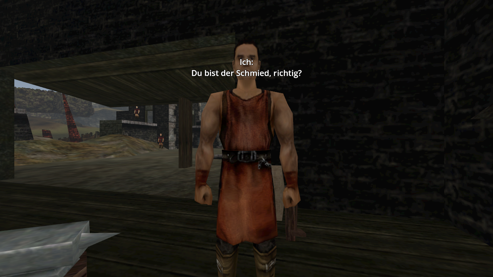
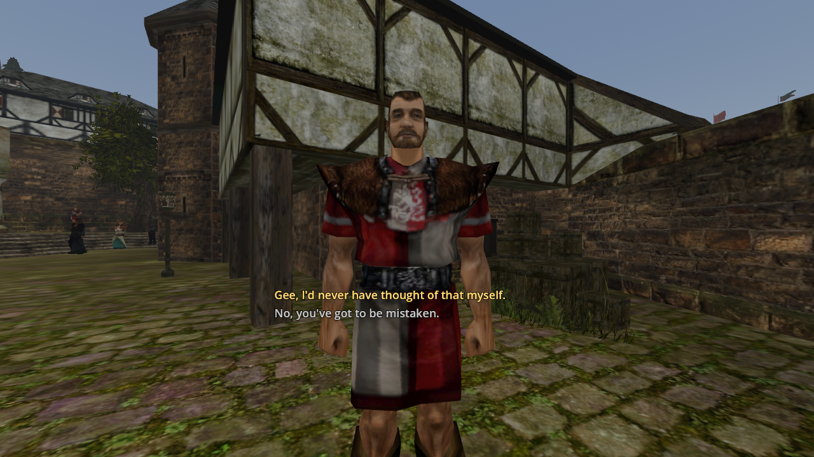

- Gothic's dialogs on the same Daedalus VM as the AI, following Gothic-Unity's dialog flow: the NPC's infos (C_INFO, sorted by number), important ones start by themselves, the others are offered while their condition is true and they weren't told (or are permanent). Info functions run with self = the NPC, other = the hero.
- Externals: AI_Output (line with voice and subtitle), Info_AddChoice / Info_ClearChoices (sub choices, newest first like the engine), AI_StopProcessInfos, AI_ProcessInfos (an NPC with an important info talks to a hero within 5 m), Npc_KnowsInfo, Npc_CheckInfo, InfoManager_HasFinished, plus Hlp_GetInstanceID, Npc_IsPlayer, Hlp_StrCmp, Npc_GetTrueGuild that conditions need.
- Voices: Gothic's speech WAVs as Godot streams; IMA ADPCM decoded by Gothic-Unity's own decoder from the shared core. NPC lines play at the NPC, the hero's in the head. Subtitles from OU.BIN.
- The NPC stops its routine, turns to the hero and gestures (T_DIALOGGESTURE_xx) while it speaks; the hero is pinned (no walking, turning or teleporting), the head can look around.
- In VR: the NPC in front within 3 m gets a name tag, the trigger talks; subtitles and choices on a panel below the eyes; choose by pointing, right stick or trigger; the trigger skips a line. Desktop: F, arrow keys / W / S / 1-9, Enter / Space / click.
- Tested without a headset (`--dialog-test=nearest`, talks to the nearest NPC with three infos, chooses, screenshots, quits): G1 Old Camp Stone, 2 choices, 6 lines, all with voice; G2 Khorinis Pablo, his important "wanted" info starts by itself, sub choices, 11 lines, all with voice.
- Found on the way:
  - Other NPCs' lines leaked into the dialog (Vatras preaching in the market place calls AI_Output from his own state): only the dialog's two speakers count now.
  - The native ZenKit library from binary-dependencies has no VFS loader for cutscene libraries (`ZkCutsceneLibrary_loadVfs` missing); OU.BIN comes from the disk like in Gothic-Unity.
  - NPCs wore placeholder textures (Stone's apron flat red): the engine swaps `_V0_C0` in body and head textures for the script's body texture and skin colour numbers (Mdl_SetVisualBody); the spike ignored them. Done now, 71 more texture layers in G1.
- Not in it yet: trade, items given in dialogs, the hero's own animations, NPCs' ambient talk, lip sync, choice text from the info manager's fonts.

## 2026-11-07 - Playable: the player walks and teleports

Decided with the owner: playable VR first, built on Gothic-Unity's shared core (see [[Porting-Strategy]], 77 core files compile unchanged into the Godot project).

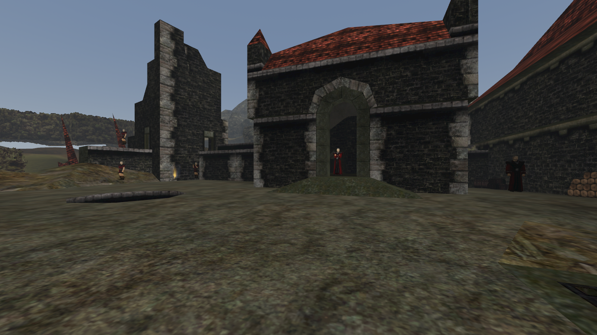
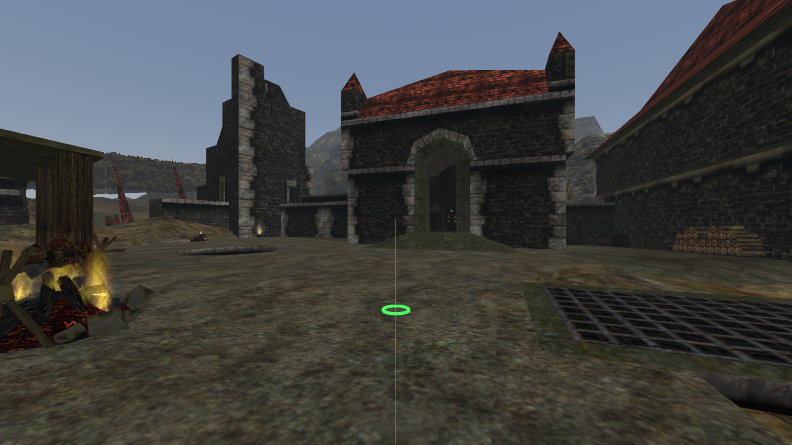

- `GothicPlayer`: a capsule (CharacterBody3D) with Gothic-Unity's VR movement values - walk 1.5 m/s, run 3.5 m/s, 45° snap turn, 0.5 m steps (Godot has no step offset: tried up, forward, down when blocked), slope limit = the hero's SLIDE_ANGLE (G1 45°, G2 50°), gravity.
- XR: XROrigin3D with head and both hands (simple hand boxes for now); room scale - the capsule follows the head with collision, the origin moves back; left stick moves (pressed: run), right stick snap-turns around the head, right stick forward aims the teleport. Desktop: WASD, mouse, Shift, Q/E, T. Built against Godot's default OpenXR action map; not tried in a headset yet.
- Teleport: throw parabola from the hand, valid on floor within the slope limit, at most 1.5 m above the feet (Gothic-Unity's rule), with room for the body; green or red line and ring.
- Collision: the world plus every object Gothic marks cdStatic (fences, barrels, mobs - not grass or bushes).
- The NPCs' hero is the player now: their perceptions measure the distance to where you stand.
- Found on the way: a spawn point can be inside a hill (the Old Camp ring's centre lies below the castle yard), so the ground is searched from 100 m above.
- Tested without a headset (`--walk-test`, `--teleport-test`): walks on the yard at 1.5 m/s, stops at a wall, walks downhill; teleports 5.6-5.9 m along the yard, refuses a target on a wall.

## 2026-11-07 - Gothic 2: Khorinis

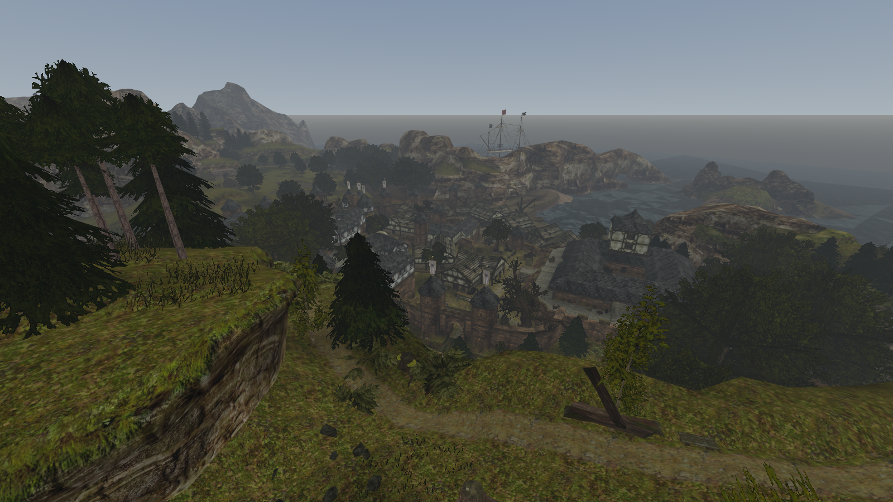
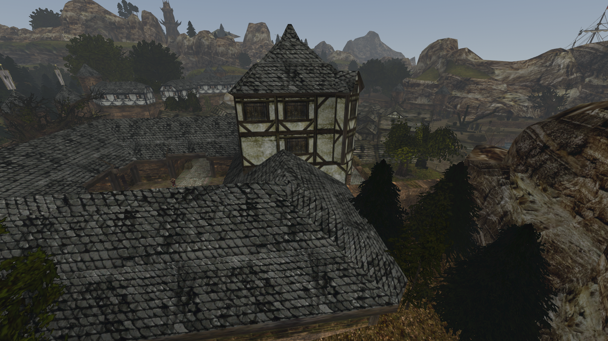
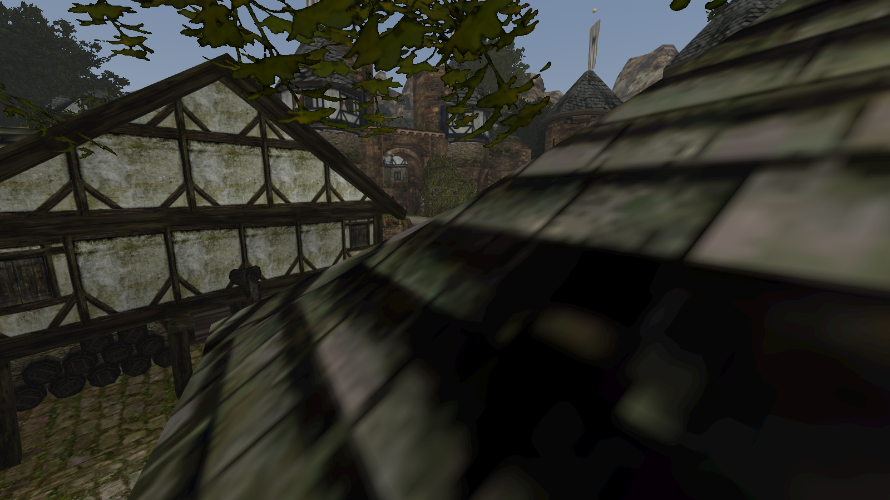
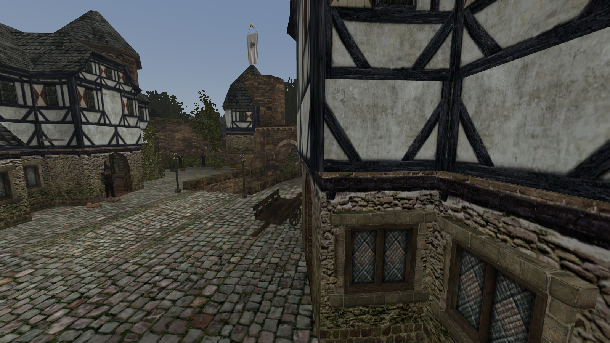

- `--game=2`: NEWWORLD.ZEN with Gothic 2's data, camera in the middle of the city waypoints, G2's STARTUP_NEWWORLD for the scripted NPCs (1054 inserted, 180 humans within 150 m of the city, 59 monsters left out as the spike only has the human skeleton), armours and heads from the scripts.
- G2 world: 461283 polygons, 12410 objects of 373 meshes (9 not found), 666 particle emitters, 508 texture layers, 2.7 million triangles with the objects merged.
- **ZenKit's world mesh cache doesn't scale**: `Mesh.Cache()` copies the whole mesh including its light maps into managed memory; G2 peaked at ~4.5 GB and ran out of memory under a 5 GB limit. Reading the mesh natively (positions and features in bulk, polygons one by one, like Gothic-Unity does) needs 98 MB and is faster too: G1 world polygons 0.5 s instead of 1.6 s, G2 loads in 4.7 s on the desktop.
- Collision now only for the world itself (G2: 462k triangles instead of 2.7 million with the objects).
- Quest numbers for Khorinis: pending - the headset dropped off USB (battery after hours with the proximity sensor overridden).

Estimate until then: G1 and G2 on the desktop with the settings measured on the Quest (one Quest eye's resolution 2064x2208, MSAA 2x, objects 80 m, particles 40 m, animation culling, occluders, scripted NPCs, the same turning camera), then G2 on the Quest = G1 on the Quest x (G2 / G1 on the desktop) for each cost:

| | G1 desktop | G2 desktop | G2 / G1 | G1 Quest 3, 120 Hz (measured) | G2 Quest 3 (estimate) |
|---|---|---|---|---|---|
| GPU (Godot's timer) | 0.32 ms | 0.41 ms | 1.28 | 4.27 ms (VrApi app GPU 4.67) | ~5.5 ms (app GPU ~6.0) |
| Render CPU | 0.45 ms | 0.59 ms | 1.31 | 1.42 ms | ~1.9 ms |
| Draw calls | 31 (12-63) | 77 (27-111) | 2.5 | 20-129 | ~50-320 |
| Triangles | 97k | 315k | 3.2 | 91k-166k | ~290k-530k |
| AI | 5.7 ms/s | 3.0 ms/s | 0.5 | 15-50 ms/s | ~10-30 ms/s |
| Animation | 0.23 ms | 0.32 ms | 1.4 | 0.74-0.97 ms | ~1.0-1.4 ms |

- Within the 120 Hz budget on paper (8.3 ms GPU, CPU well below), 90 Hz with room. The weak spot is the triangle count: 3.2 times more triangles cost the desktop GPU only 28% more, but a tile-based mobile GPU pays more per triangle, so ~6-7.5 ms GPU on the Quest is possible - tight at 120 Hz, fine at 90 Hz.
- Gothic-Unity on the Quest 3 for comparison (2026-11-03): G2 at 120 Hz 98.8 FPS average in gameplay; Khorinis with a short object distance 115 FPS at 6.1 ms GPU, with a long one at night 74-84 FPS at 9.2 ms.
- To confirm on the headset: `tools/quest-bench.sh 30 --hz=120 --game=2 --ai=true --object-far=80 --pfx-far=40 --anim-far=80 --occluder-area=2 --msaa=2`.

## 2026-11-07 - Frame spikes: garbage from ZenKit's external calls

- With the GPU at 71-74% at 120 Hz, 6-8 frames per second still missed. Logging what long frames had in common: 2-16 ms of AI time in a single script call.
- Those calls were garbage collections (gen0 and gen1) every 1-4 s: 2.5-5.5 ms on the desktop, 10-16 ms on the Quest's MonoVM. Two causes:
  - The heap still held ~1.2 GB of loading garbage (the cached ZenKit world mesh and builder data), which makes every collection slower. Fix: one full, compacting collection right after loading (1224 MB -> 14 MB).
  - ZenKitCS allocates ~430 bytes per external call (new VM and symbol wrappers, a finalizable instance wrapper per instance parameter, boxing): ~1.5 MB/s with 134 NPCs. Fix: a small ZenKitCS patch, see [[Upstream-Forks]]. Allocations inside script calls ~1500 -> ~10 KB/s, no collections in a 25 s run.
- Quest 3, 120 Hz, 134 scripted NPCs, objects 80 m, particles 40 m, animation culling, occlusion culling, MSAA 2x: **119.1 FPS average (minimum 111), stale frames 3.8 per second, no garbage collection**.
- What is left: 1-3 long frames per second from the spike's own path search when an NPC starts walking (breadth-first search over the whole waynet, nearest waypoint by scanning all of them) - spike code, not ZenKit or Godot.

## 2026-11-07 - Where the Quest 3 stands at 120 Hz

Old Camp, 134 scripted NPCs (routines, AI states), objects to 80 m, particles to 40 m:

| Variant | FPS avg (min) | App GPU | GPU busy | CPU (busiest core) | Stale frames | NPC animation |
|---|---|---|---|---|---|---|
| MSAA 4x | 110.1 (89) | 6.95 ms | 95% | 30% (50%) | 14.6/s | 1.8-2.1 ms, all 134 |
| MSAA 4x, animation culled (80 m, outside the view) | 110.0 | 6.53 ms | 91% | 25% (30%) | 12.1/s | 0.74-0.97 ms, 6-19 animated |
| MSAA 2x, culled | 115.4 (58) | 6.19 ms | 87% | 25% (29%) | 7.0/s | |
| MSAA 2x, culled, objects 60 m, particles 30 m | 116.9 (82) | 5.61 ms | 80% | 24% (28%) | 7.7/s | |
| Godot's separate render thread | 46.4 (40) | 7.75 ms | 54% | 54% (65%) | 78/s | 12-15 GC per second |

- About 110 of 120 FPS with full quality, 115-117 with MSAA 2x.
- Godot's own render timers (viewport render time measurement) on the Quest at 120 Hz, MSAA 4x: the main thread records a frame in about 1.0 ms (frame setup 0.2 ms), the GPU needs 7.4-8.6 ms per frame - right at the 8.3 ms budget. The missed frames are GPU frames running over, not the main thread (a first reading of VrApi's CPU-to-GPU latency suggested ~6 ms main thread; that number includes waiting).
- Godot's separate render thread is no help here (46 FPS, many garbage collections).
- Animation culling (hide and stop NPCs beyond the object distance, keep the pose outside the view, update far ones less often) cuts the bone work from ~2 ms to under 1 ms; the rest is the per-NPC distance and view check.
- Occlusion culling with occluders built at runtime (per 64 m cell, world triangles of at least 2 m²; Godot's ArrayOccluder3D) at 120 Hz, MSAA 4x: app GPU 6.85 -> 4.97 ms, draws 256-383 -> 20-131, FPS 112.8 -> 116.0, stale frames 10.8 -> 8.3 per second; the CPU pays ~0.35 ms per frame for it. With MSAA 2x on top: 4.67 ms GPU, 116.0 FPS, 6.4 stale per second.
- With the GPU at 71-74% the remaining 6-8 missed frames per second are spikes, not load: next is finding them (frame time histogram against garbage collections, AI state loops, the particle culler).

## 2026-11-07 - Daily routines and AI states on the Quest

The question: animations and daily routines cost time too. So the spike now runs the Old Camp's real NPCs the way Gothic-Unity's AiHandler does:
- G1's STARTUP_OLDCAMP inserts them (137, 134 within 150 m of the camp), each initialised from its Daedalus instance; the look comes from `Mdl_SetVisualBody` (body, head, armour item's visual).
- Each NPC's daily routine (`Rtn_*` -> `TA_*` -> `TA_Min`, 655 entries) places it at its current routine waypoint (12:00) and starts its AI state.
- State machine like AiHandler: state start, `_LOOP` when the action queue is empty and at most once per perception time, `_END`, next routine; active perception (assess player) on the perception timer when the hero is within 20 m.
- Actions from the scripts: `AI_PlayAni` (with the animation's follow-up), `AI_Wait`, `AI_GotoWP` (walking the waynet), `AI_StartState`; about 20 externals implemented, the rest default.

Quest 3, 72 Hz, objects to 80 m, particles to 40 m, 134 scripted NPCs:

| | Value |
|---|---|
| FPS | 71.8 average, 70 minimum |
| App GPU | 9.13 ms (77% busy) |
| CPU | 26% (busiest core 33%) |
| AI (scripts and actions) | 15-50 ms per second, 0.2-0.7 ms per frame |
| of that in the Daedalus VM | 10-29 ms per second |
| Script activity | 86-123 state loops, 6-9 perceptions, 3300-4900 externals per second |
| Animation (bone writes) | 2.3-2.6 ms per frame |
| Garbage collection | at most one small collection in a second |

The routines and states cost far less than feared (a few percent of one core). Per frame, the bone writes are the bigger CPU cost - the bulk bone path from [[Godot-Risks]] R4 is worth doing. Not in the load yet: NPCs perceiving each other (fights, gossip), dialogs, physics and collision of NPCs, sound, animation blending and overlays; most externals are still the cheap default.

## 2026-11-07 - Game logic on the Quest: Daedalus VM

GOTHIC.DAT in ZenKit's Daedalus VM, all 1524 dialog condition functions (DIA_*_CONDITION) called in a loop; externals land in C# (three typed ones as Gothic-Unity registers them, the rest in the default handler), so every external is a native to C# callback plus the P/Invokes ZenKit uses to read its arguments.

| Runtime | GOTHIC.DAT load | Condition calls | Per condition | Per external (with its script) |
|---|---|---|---|---|
| Desktop, CoreCLR | 21 ms | 874 per ms | 1.14 µs | 0.84 µs |
| Quest 3, MonoVM | 42 ms | 165 per ms | 6.04 µs | 4.43 µs |

| Quest 3, NativeAOT (linux-bionic) | 34 ms | 177 per ms | 5.64 µs | 4.14 µs |

5.3 times slower on the Quest than on the desktop, and NativeAOT wins only 7% over MonoVM: the native/managed transitions are not the cost, the Quest's CPU and ZenKit's own work per call are (the same that Gothic-Unity's IL2CPP build pays). Rough budget: 60 active NPCs running state loops with ~10 externals each at 72 Hz are ~43000 externals per second, about 190 ms per second, a fifth of one core. Workable. The place to win time back is fewer calls (ZenKit's C# binding reads every argument with its own P/Invoke), not the runtime.

NativeAOT on the Quest works (export preset "QuestAOT", NDK clang on PATH, `PublishAot` for linux-bionic, ZenKit kept from trimming; Godot logs a harmless "can't open libmonosgen" once). Old Camp at 72 Hz: 71.7 FPS, NPC bones 0.90 ms for 60 humans and 1.98 ms for 150 - about the same as MonoVM (1.0-1.2 ms and 1.94 ms). MonoVM is good enough; NativeAOT stays an option.

## 2026-11-07 - Quest 3: the Old Camp runs native

Godot 4.7.2 .NET (MonoVM), Mobile renderer, OpenXR vendors plugin 5.1.0, MSAA 4x, foveation 3, Old Camp with the whole G1 world, 8610 objects, 450 particle emitters, 60 animated humans, camera turning 18° per second (no game logic: no AI, scripts, audio).

First run (everything drawn as far as the world, 600 m):

| Refresh | FPS avg (min) | App GPU | GPU busy | CPU (busiest core) | Draws | Triangles |
|---|---|---|---|---|---|---|
| 72 Hz | 67.2 (36) | 12.0 ms | 89% | 21% (25%) | 293-590 | 302k-586k |
| 90 Hz | 78.3 (34) | 10.9 ms | 93% | 23% (28%) | 293-591 | 302k-587k |
| 120 Hz | 87.6 (30) | 10.1 ms | 96% | 22% (27%) | 291-590 | 301k-586k |

GPU bound everywhere. Taking parts away at 120 Hz (9.96 ms with everything): alpha tested objects (trees, bushes) cost 3.3 ms and most of the triangles, all objects 2.7 ms, particles 2.7 ms (every emitter is simulated every frame), humans 0.9 ms; the bare world alone takes 3.9 ms and holds 120 FPS. 32 m cells instead of 64 m made it worse (more draws, 11.6 ms).

With Gothic's own limits back (objects drawn up to 80 m from their 64 m cell, particle effects only within 40 m):

| Refresh | FPS avg (min) | App GPU | GPU busy | CPU (busiest core) | Draws | Triangles |
|---|---|---|---|---|---|---|
| 72 Hz | 71.5 (53) | 8.35 ms | 72% | 19% (24%) | 239-360 | 115k-238k |
| 90 Hz | 90.7 (89) | 7.35 ms | 77% | 22% (26%) | 239-360 | 115k-238k |
| 120 Hz | 115.8 (61) | 6.59 ms | 91% | 25% (31%) | 240-359 | 115k-238k |
| 120 Hz, MSAA 2x | 116.8 (67) | 5.88 ms | 84% | 27% (31%) | 240-360 | 115k-238k |
| 120 Hz, 150 humans | 111.0 (48) | 7.15 ms | 94% | 30% (48%) | 280-402 | 132k-279k |

- No garbage collection at all while running (0 collections per second), managed heap 1.2 GB after loading.
- Human bones from C# on MonoVM: 0.27-0.3 µs per call, 1.0-1.2 ms per frame for 60 humans, 1.9 ms for 150. Close to the desktop (CoreCLR) numbers.
- Loading on the Quest: world built in 6.2 s (from the raw Gothic files, no cache), app start to first frame 20.7 s.
- For comparison, Gothic-Unity on the same Quest 3 (2026-11-03, full game, other scene): G1 72 Hz average 70.4 FPS with app GPU 3.7-8.2 ms; G1 120 Hz about 91 FPS in the Old Camp at night.
- Quest launch traps found on the way: see [[Toolchain]] (prebuilt template has no OpenXR loader, controller check blocks launches, launch arguments are dropped, refresh rate property).

## 2026-11-07 - NPCs, mobs and fire

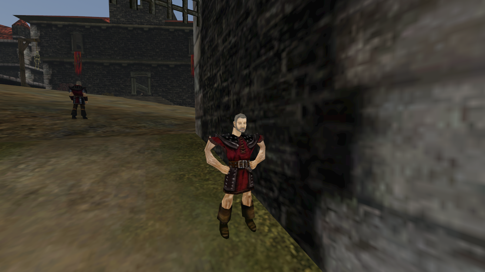
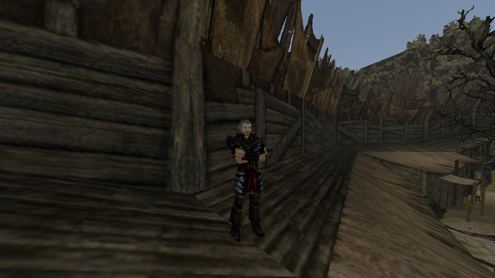
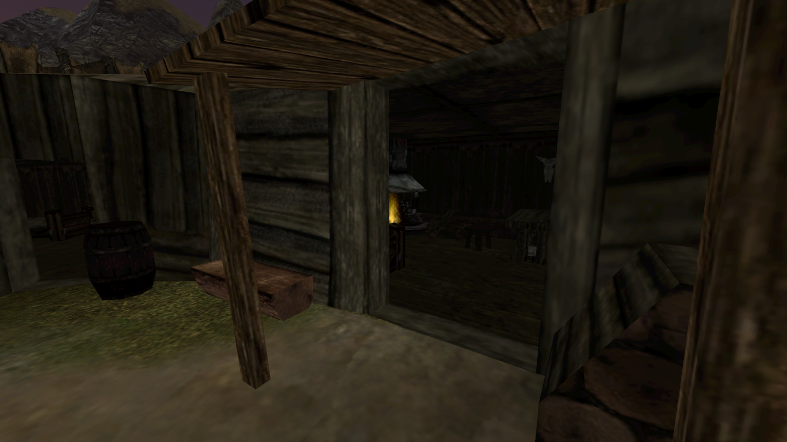
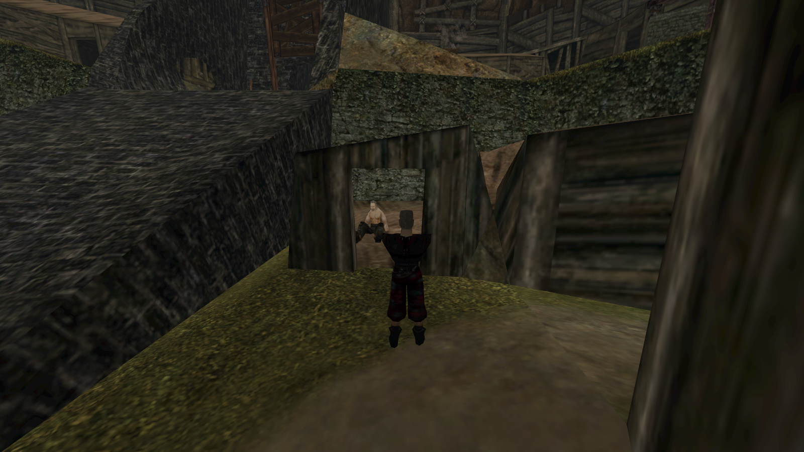
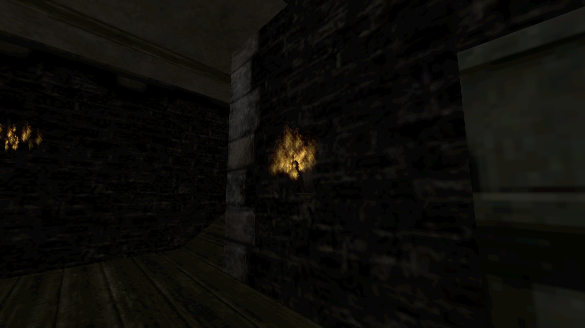
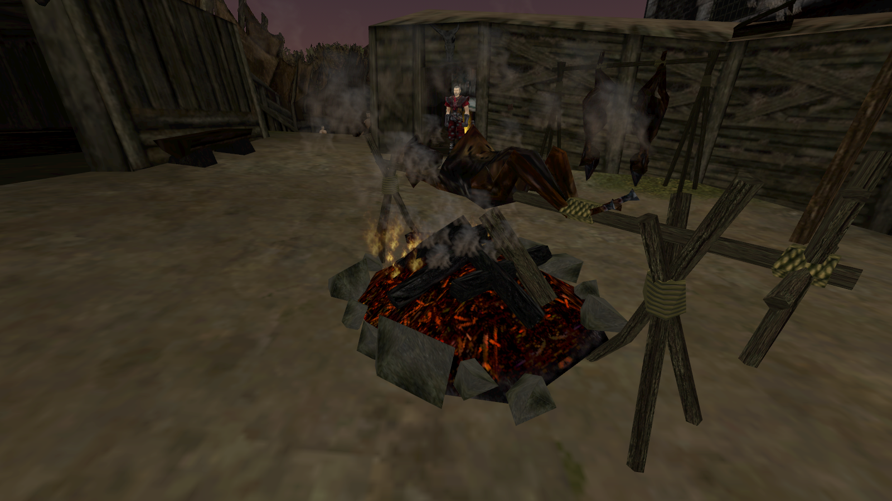

- **Humans**: HUMANS.MDH skeleton (34 bones) as a Skeleton3D, armours and bodies (.MDM soft skin) as skinned meshes with one Skin binding every node, heads (.MMB) on a BoneAttachment3D at "BIP01 HEAD", Gothic animations (.MAN: S_RUN, S_LGUARD, S_HGUARD, S_SIT) baked per frame and written bone by bone from C# every frame. Spawned at Old Camp waypoints, feet put on the ground by a ray.
- Armours are modelled in another pose than the skeleton: their soft skin positions are 13-19 cm (guard armour) or 3-4 cm (shadow armour) off the rest pose, only the naked body matches. The first renders used them and the guards' arms looked off. Vertices now come from the weights' own bone offsets (sum of weight x bone rest x offset), like the engine and Gothic-Unity's armour position cache.
- Conversions that held: bind poses from the hierarchy rest with the root at RootTranslation, animation rotations as `(x, y, -z, w)` of Gothic's stored quaternion (Gothic-Unity negates w; the z mirror flips x and y on top), root bone keeps only its height.
- **Mobs** (.ASC and .MDS visuals: beds, chairs, benches, chests, doors, torch holders, cauldrons): mesh attachments at their hierarchy nodes in rest pose, merged into the world cells like the static objects. 8610 objects of 351 meshes, 11 not found.
- **Particles**: torches, fires, smoke, coal glow from their C_ParticleFX instances in PARTICLEFX.DAT (450 emitters, all found), on GPUParticles3D in Gothic's units (cm to m, ms to s, velocity cm/ms x10, gravity cm/ms² x10000), animated textures as flipbook atlases, ADD/BLEND/MUL blending. Gothic-Unity scales emission and velocity by guessed factors; this maps the units directly.
- **Collision**: the merged world as Jolt trimesh shapes (979k triangles) built in about a second, used for ground snapping and to frame screenshots.

R4 measured (desktop, CoreCLR, one frame):

| Humans | Bone calls | Time | Per call |
|---|---|---|---|
| 60 | 3450 | 0.79 ms | 0.23 µs |
| 150 | 8598 | 1.2-1.5 ms | 0.14-0.17 µs |

Two calls per bone (position, rotation). On the Quest (MonoVM, slower cores) expect several times more; the bulk paths in [[Godot-Risks]] R4 get measured there.

## 2026-11-07 - Old Camp renders in Godot

First Gothic 1 world in Godot 4.7.2 (C#, Mobile renderer), desktop, rendered headless with gamescope.

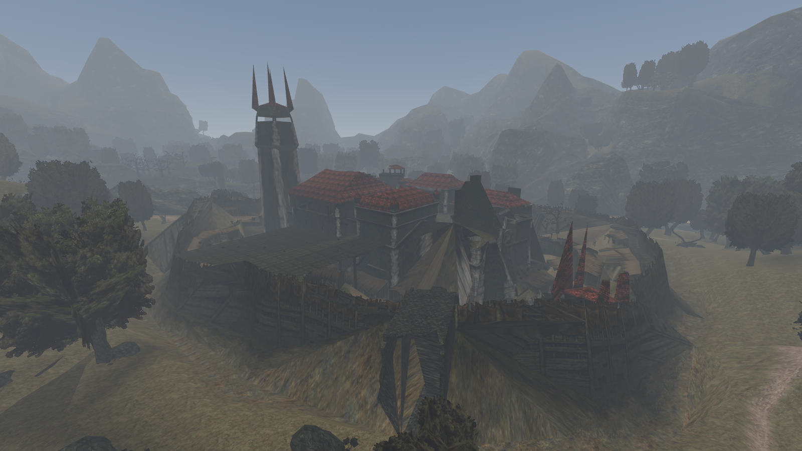
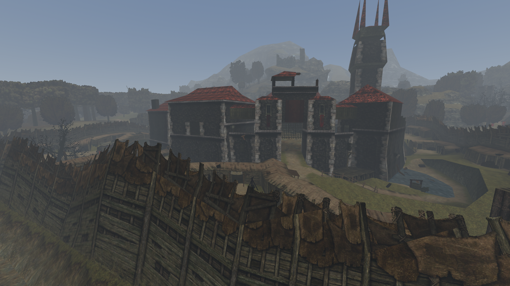
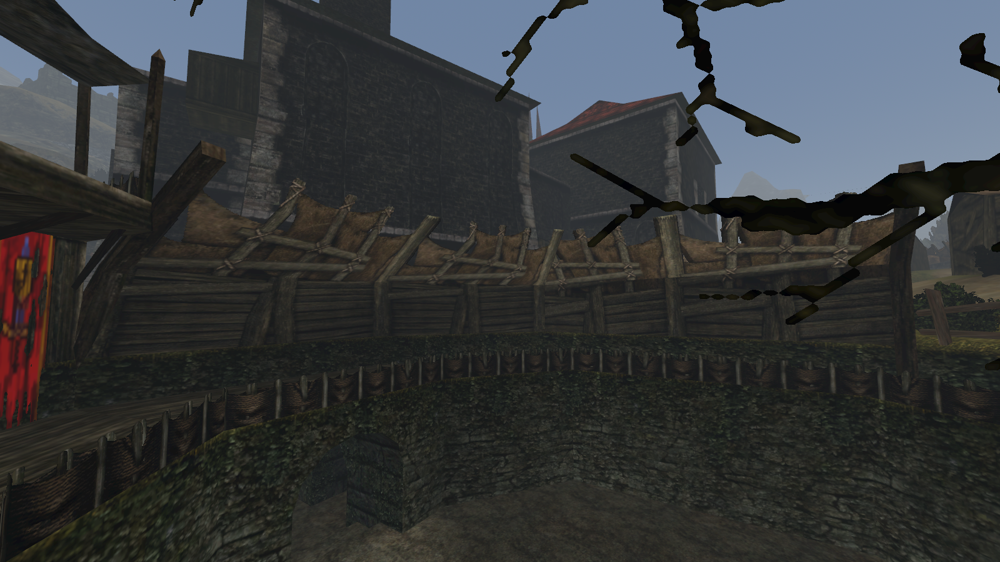
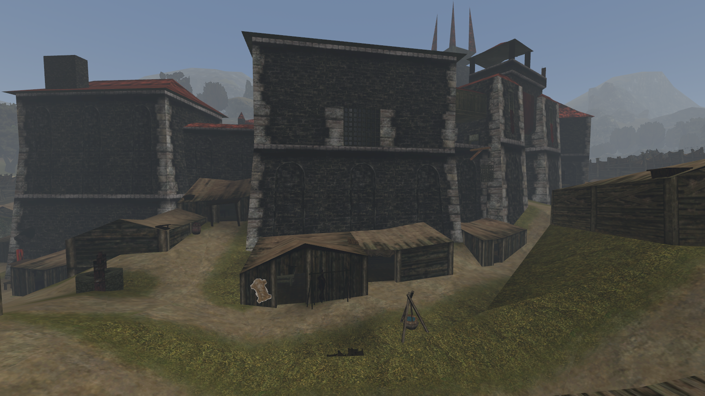
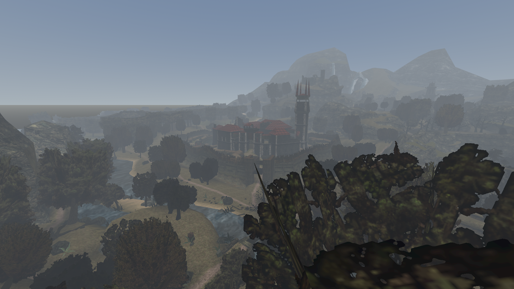
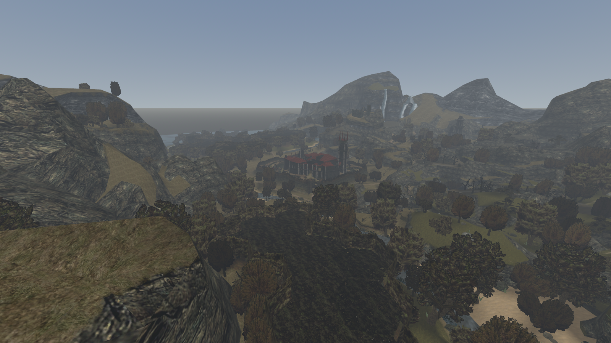

What is in it:
- World mesh from ZenKit, only the polygons the BSP leaves reference (like Gothic and Gothic-Unity), cut into 64 m cells per kind (opaque, alpha tested, water): 636 meshes, 107k triangles.
- 7214 static objects (.3DS / MRM), 271 shared meshes, merged into the world cells (or one node each with `--vob-mode=nodes`).
- One texture array (409 layers of 256 px, every texture scaled to the layer size) shared by everything.
- Gothic's baked vertex light on the world; objects take the light of the world below them (like Gothic's ground polygon light), plus a little sun shading.
- Procedural sky and thin fog instead of Gothic's sky layers, 1.5 km camera range.

Not in it: NPCs and animated models, mobs (.ASC), decals, particles, Gothic's sky, light maps of rooms, day time.

Findings:
- The world mesh holds 32565 polygons (of 138215) that no BSP leaf references: low detail copies overlapping the real geometry. The first renders drew them and got slanted slabs around the castle ("the height map gets funky around the center"). Drawing only BSP leaf polygons fixed it.
- ZenKit works unchanged in Godot C# (.NET 8 desktop): VFS, world, meshes, textures. Native library resolution through `NativeLibrary.SetDllImportResolver`.
- Loading on the desktop: world 1.1 s, world mesh 1 s, objects 0.3 s, texture array 0.1 s.
- Managed memory 910 MB after loading, mostly the cached ZenKit world mesh and the builder lists. Too much for a Quest; the port needs Gothic-Unity's static cache approach (or streaming).
- Draw calls in Old Camp views: 3600-4300 with one node per object, far above the Quest budget (400-600), as expected from [[Godot-Risks]] R2. Merging the objects into the world cells (their light baked into the vertex colour, one texture array) brings it to 218-580 with a 1.5 km view. Cost: 370k-710k triangles per view, as whole cells are drawn; Gothic's object fade distance (and lower detail far away) has to come back for the Quest. Merged load adds 0.8 s and 180 MB managed memory (1093 MB total).
- Godot's per-instance shader parameters share one global buffer: 7214 instances overflowed the default, raised `rendering/limits/global_shader_variables/buffer_size` to 262144.
- Coordinates: Gothic is left-handed, Godot right-handed. Mirroring z keeps the world readable; triangle corners are then reversed (world fans 0, p+1, p; mesh triangles w0, w2, w1) and rotations become `S * R * S` with `S = diag(1, 1, -1)`. Every position, rotation and animation in the port goes through this one conversion.

Quest pipeline (paused for the renders):
- The prebuilt Android export (no gradle) needs the C# project on net9.0 and builds (MonoVM, ZenKit and dmusic land in `lib/arm64-v8a`), but contains no OpenXR loader and no VR launcher category, so the Quest would start it as a flat panel.
- A Quest build needs the gradle build plus the OpenXR vendors plugin (5.1.0, Meta plugin enabled). SDK packages for that are installed; the gradle build is the next step.
- G1 data is on the Quest in the app's folder (copied on the device from Gothic-Unity's folder).

## 2026-11-07 - Start

- Repository created from Gothic-Unity main (5e2ca3f2b, after #476).
- Risk research written down: [[Godot-Risks]]. Spike defined: [[Spike-Plan]].
